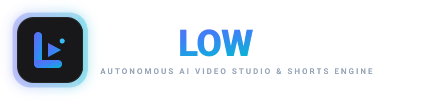
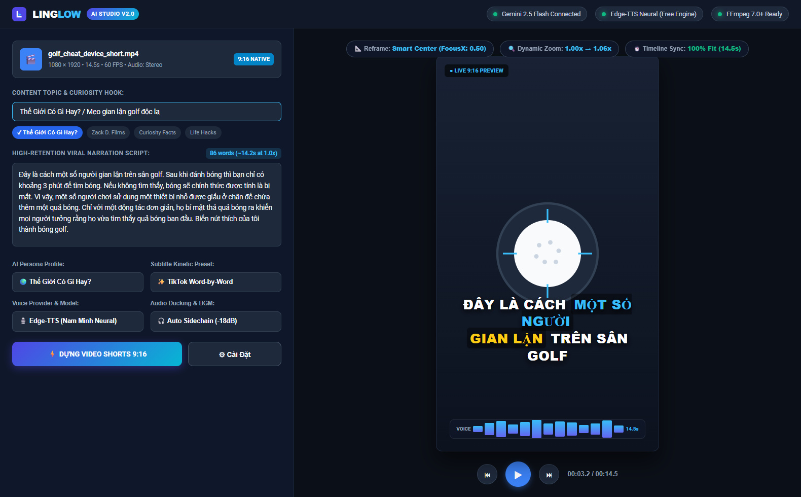
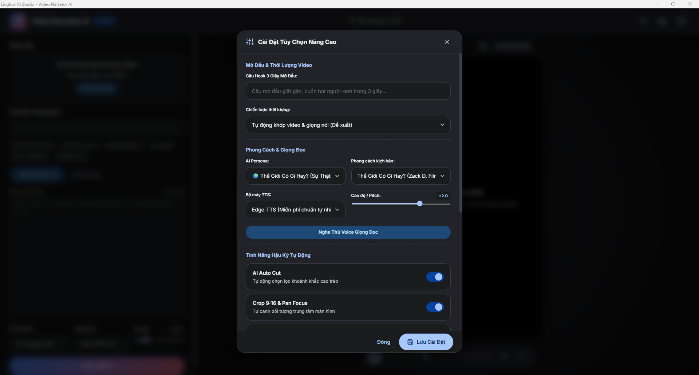
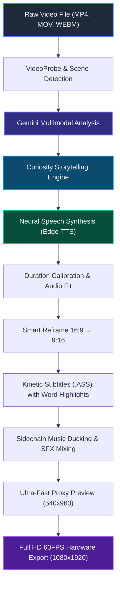

<p align="center">
  <a href="https://github.com/kiyogo/linglow">
    
  </a>
</p>

<p align="center">
  <strong>Autonomous AI Video Studio &amp; Viral Shorts Generation Engine</strong>
</p>

<p align="center">
  <a href="https://github.com/kiyogo/linglow/blob/main/LICENSE"></a>
  <a href="https://dotnet.microsoft.com/download/dotnet/8.0"></a>
  <a href="https://ffmpeg.org/"></a>
  <a href="https://aistudio.google.com/"></a>
  <a href="https://github.com/rany2/edge-tts"></a>
  <a href="https://github.com/kiyogo/linglow/actions"></a>
</p>

---

## 🌟 Overview

**Linglow** is a production-ready, autonomous Windows desktop application engineered in **C# .NET 8**, **WPF (MVVM)**, **Microsoft WebView2**, and **FFmpeg**. It bridges cutting-edge Multimodal AI (Google Gemini Vision) with high-fidelity Text-to-Speech (Edge-TTS Neural, ElevenLabs, OpenAI) to automate the entire short-form video creation lifecycle.

From raw horizontal footage or screen recordings, Linglow autonomously detects scenes, extracts visual context, writes high-retention viral scripts, synthesizes human-like voiceover, dynamically reframes into vertical **9:16 (TikTok, YouTube Shorts, Instagram Reels)**, synchronizes word-by-word kinetic subtitles, and masters audio with automatic sidechain ducking.

---

## 📸 Application Showcase

### Main Studio Dashboard
<p align="center">
  
</p>

### Advanced Settings & AI Model Configuration
<p align="center">
  
</p>

---

## ✨ Key Features

### 🧠 Autonomous Visual Perception & Context Recognition
- **Multimodal Video Ingestion**: Streams frames and audio directly into Gemini File API / Vision models to analyze action, objects, facial expressions, and text overlays (OCR).
- **Scene Transition Detection**: Automatically tags scene boundaries, cut points, and high-impact climax moments without human intervention.

### ✍️ High-Retention Curiosity Storytelling ("Thế Giới Có Gì Hay" / Zack D. Films Style)
- **Engineered Viral Blueprint**:
  1. **Instant Hook (0-2s)**: Bold, curiosity-inducing opening statement (`"Here is how some people cheat on a golf course..."` / `"Why did this city dump 96 million black plastic balls into a reservoir?"`). Zero generic bot cliches or greetings.
  2. **Rule & Tension (2-5s)**: Concise constraints and rules of the situation with precise metrics (e.g., *"3 minutes to find the ball before it's lost"*).
  3. **Mechanism & Action Reveal (5-12s)**: Step-by-step breakdown of how the hidden tool, trick, or scientific phenomenon works on screen.
  4. **Creative Interactive CTA (12-15s)**: Engaging audience hook tied directly to the visual object (`"Turn my like button into a golf ball"`).
- **Anti-Cliché Quality Filter**: Hard-coded heuristics strip away repetitive AI templates, PR buzzwords, and machine translations.

### 🎙️ Multi-Engine Speech Synthesis & Expressive Prosody
- **Edge-TTS Neural**: 100% free, unlimited, zero-subscription neural voiceover with native Vietnamese (`vi-VN-NamMinhNeural`, `vi-VN-HoaiMyNeural`) and 100+ global languages.
- **OpenAI & ElevenLabs Support**: Seamless API integration for premium voice cloning and character acting.
- **Dynamic SSML Breathing**: Automatically inserts subtle human breath marks (`<break time="200ms"/>`) and pitch modulation for natural narration cadence.

### 📐 Smart 9:16 Reframe & Kinetic Camera Effects
- **Subject-Centric Cropping**: Transforms 16:9 widescreen into vertical 9:16 while locking onto the focal point (`FocusX`, `FocusY`).
- **Dynamic Micro-Zooms**: Applies progressive smooth zoom filters (1.00x → 1.08x) during key moments to prevent viewer scroll-away.

### 💬 Kinetic Word-by-Word Highlighted Subtitles
- Generates Advanced SubStation Alpha (`.ASS`) styling with dynamic scale animations and highlight colors (electric cyan and yellow) on keywords, numbers, and action verbs.

### 🎚️ Studio-Grade Sidechain Audio Ducking
- Integrates complex FFmpeg multi-input audio filtergraphs: background music automatically dips by -18dB whenever narration speaks and smoothly returns during pauses.

---

## ⚡ Video Production Pipeline



---

## 📁 Repository Structure

```text
linglow/
├── .github/
│   └── workflows/
│       └── build.yml               # GitHub Actions CI for .NET 8 WPF
├── Assets/                         # Scripts & runtime assets
│   ├── ffmpeg/                     # FFmpeg/FFprobe binaries directory (.gitkeep)
│   └── scripts/                    # Python worker utilities
├── VideoNarrator/                  # Core WPF Project
│   ├── VideoNarrator.csproj        # .NET 8-windows win-x64 specification
│   ├── App.xaml / App.xaml.cs      # Entrypoint & DI Service Registration
│   ├── MainWindow.xaml / .cs       # Studio Shell & WebView2 host
│   ├── Models/                     # Data models (EditingPlan, Persona, Subtitle)
│   ├── ViewModels/                 # MVVM ViewModel & UIBridge for WebView2
│   ├── Services/
│   │   ├── GeminiService.cs        # Gemini File & GenerateContent API client
│   │   ├── EditingPlanService.cs   # Auto Editing Plan compilation
│   │   ├── FfmpegService.cs        # Process execution & complex filtergraphs
│   │   ├── TtsService.cs           # Edge-TTS & SSML processor
│   │   ├── SubtitleService.cs      # ASS subtitle generator
│   │   └── PersonalityEngine/      # System prompt builders, personas & few-shots
│   └── wwwroot/                    # Modern responsive Studio UI
│       ├── index.html              # Studio canvas
│       ├── app.js                  # Studio controller & UIBridge interop
│       └── style.css               # Dark theme design system
├── docs/                           # Documentation and media
│   └── assets/                     # SVG logo and screenshots
├── .env.example                    # Environment template
├── .gitignore                      # Git ignore rules
├── build.bat                       # Automated release packaging script
├── LICENSE                         # MIT License
└── README.md                       # Comprehensive documentation
```

---

## 🚀 Quick Start Guide

### Prerequisites
1. **Operating System**: Windows 10 / 11 (64-bit).
2. **.NET SDK**: [.NET 8.0 SDK](https://dotnet.microsoft.com/download/dotnet/8.0).
3. **FFmpeg**: [FFmpeg 7.0+ Binaries](https://ffmpeg.org/download.html) placed in `VideoNarrator/Assets/ffmpeg/` (`ffmpeg.exe` and `ffprobe.exe`) or added to system `PATH`.
4. **Google Gemini API Key**: Obtain a free API key from [Google AI Studio](https://aistudio.google.com/).

### Installation

1. **Clone the repository:**
   ```bash
   git clone https://github.com/kiyogo/linglow.git
   cd linglow
   ```

2. **Configure environment:**
   ```bash
   copy .env.example .env
   ```
   Open `.env` and set your `GEMINI_API_KEY`:
   ```env
   GEMINI_API_KEY=your_actual_gemini_api_key
   GEMINI_MODEL=gemini-2.5-flash
   ```

3. **Restore & Build:**
   ```bash
   dotnet restore VideoNarrator.sln
   dotnet build VideoNarrator.sln -c Release
   ```

4. **Run the Studio:**
   ```bash
   dotnet run --project VideoNarrator/VideoNarrator.csproj
   ```
   *Or execute `build.bat` to compile a standalone single-file binary.*

---

## 🏷️ Repository Topics

Recommended GitHub repository topics:
`ai-video-generator` • `shorts-creator` • `tiktok-automation` • `gemini-api` • `edge-tts` • `video-editing` • `dotnet8` • `wpf` • `ffmpeg` • `voiceover-ai` • `reels-generator`

---

## 🤝 Contributing

Contributions are welcome! Please feel free to submit a Pull Request or open an Issue for feature suggestions, additional TTS providers, or new storytelling personas.

1. Fork the Project.
2. Create your Feature Branch (`git checkout -b feature/AmazingFeature`).
3. Commit your Changes (`git commit -m 'Add some AmazingFeature'`).
4. Push to the Branch (`git push origin feature/AmazingFeature`).
5. Open a Pull Request.

---

## 📄 License

Distributed under the **MIT License**. See [`LICENSE`](LICENSE) for more information.

---

<p align="center">
  Crafted with ❤️ by <a href="https://github.com/kiyogo">kiyogo</a>
</p>
